# Points Of Interest

* [Overview](#overview)
    - [Flow](#flow)
    - [Use cases](#use-cases)
    - [Queries](#queries)
    - [Health checks](#health-checks)
* [Installation](#installation)
    - [Repository](#repository)
    - [Configuration](#configuration)
    - [Tests](#tests)
    - [Review](#review)
    - [Reports](#reports)
* [Environment setup](#environment-setup)
    - [Access URLs](#access-urls)
    - [Environment variables](#environment-variables)

## Overview

Implementation of
the [Pontos de Interesse por GPS](https://github.com/backend-br/desafios/blob/master/points-of-interest/PROBLEM.md)
challenge from the backend-br repository. Company XY Inc. builds GPS receivers and needs a platform that guides people
to points of interest. This service registers a point of interest at the coordinates a receiver reported for it,
publishes the registration through a transactional outbox, and lists the points back, either in full or narrowed to
those within a maximum distance of a reference point.

A point carries a name and the coordinates it sits at on the plane, both measured in metres from the origin and never
negative. A proximity search compares the straight line between the point and the reference as less than or equal to
the given distance, and the comparison runs in the database over integer arithmetic, so no point is ever loaded into
memory to be discarded. The points the service ships with are seeded by the migrations:

| Point of interest | X coordinate | Y coordinate |
|:------------------|-------------:|-------------:|
| Lanchonete        |           27 |           12 |
| Posto             |           31 |           18 |
| Joalheria         |           15 |           12 |
| Floricultura      |           19 |           21 |
| Pub               |           12 |            8 |
| Supermercado      |           23 |            6 |
| Churrascaria      |           28 |            2 |

Given the reference point (x=20, y=10) and a maximum distance of 10 metres, the service answers Lanchonete, Joalheria,
Pub, and Supermercado.

The HTTP contract is published in `openapi.yaml` at the repository root and detailed in the documentation pages linked
below. To exercise it, import the [Postman collection](docs/postman/points-of-interest.postman_collection.json). It
covers every operation, and running it top to bottom against a local stack registers a point and reads it back. It
carries its own `baseUrl`, so no environment import is needed to point it at `http://points-of-interest.localhost:8290`.

### Flow





The domain events view shows the commands that raise each event and the aggregate that owns it. No consumer reacts
to them yet.

Sources: [points-of-interest-flow.html](docs/diagrams/points-of-interest-flow.html),
[points-of-interest-events.html](docs/diagrams/points-of-interest-events.html).

### Use cases

- [Register a point of interest](docs/USE_CASES.md#register-a-point-of-interest)

### Queries

- [Find points of interest](docs/QUERIES.md#find-points-of-interest)

### Health checks

- [Liveness check](docs/HEALTH.md#liveness-check)
- [Readiness check](docs/HEALTH.md#readiness-check)

## Installation

### Repository

To clone the repository using the command line, run:

```bash
git clone https://github.com/gustavofreze/points-of-interest.git
```

### Configuration

To install project dependencies locally, run:

```bash
make configure
```

To update dependencies and normalize `composer.json`, run:

```bash
make configure-and-update
```

To start the application containers, run:

```bash
make start
```

To stop the application containers and drop the data volume, run:

```bash
make stop
```

### Tests

Run all tests with coverage and mutation testing:

```bash
make tests
```

Run a specific test file without coverage:

```bash
make test-file FILE=PointOfInterestTest
```

### Review

Run static code analysis:

```bash
make review
```

Fix what static code analysis can correct:

```bash
make fix-review
```

### Reports

Open coverage and mutation reports in the browser:

```bash
make show-reports
```

Show outdated direct dependencies:

```bash
make show-outdated
```

> You can check other available commands by running `make help`.

## Environment setup

### Access URLs

| Environment | DNS                                      |
|:------------|:-----------------------------------------|
| `Local`     | http://points-of-interest.localhost:8290 |

### Environment variables

Every variable the application and its migration run read. This is a proof of concept, so `.env.local` is committed at
the repository root and the `Development value` column below is the literal content of that file. Every value in it is a
local-only default and never a real credential. A deployed environment supplies its own values through the container
environment instead. The `Makefile` hands the file to Docker Compose with `--env-file`, and both the
`points-of-interest` and the `points-of-interest-migrate` services load it through `env_file`.

| Variable                           | Description                                                             | Development value                                                                                                                     |
|:-----------------------------------|:------------------------------------------------------------------------|:--------------------------------------------------------------------------------------------------------------------------------------|
| `DEBUG`                            | Whether error responses carry the exception details                     | `false`                                                                                                                               |
| `SOURCE`                           | Address the root path redirects to                                      | `https://github.com/gustavofreze/points-of-interest`                                                                                  |
| `APP_NAME`                         | Component name every log entry carries                                  | `points-of-interest`                                                                                                                  |
| `DATABASE_HOST`                    | Database host (docker service name)                                     | `points-of-interest-adm`                                                                                                              |
| `DATABASE_PORT`                    | Database port inside the compose network, published on the host as 3506 | `3306`                                                                                                                                |
| `DATABASE_NAME`                    | Schema the application reads and writes                                 | `points_of_interest_adm`                                                                                                              |
| `DATABASE_USER`                    | Database user the application connects as                               | `root`                                                                                                                                |
| `DATABASE_PASSWORD`                | Password of the application user                                        | `root`                                                                                                                                |
| `FLYWAY_URL`                       | JDBC URL the migration run connects to                                  | `jdbc:mysql://points-of-interest-adm:3306/points_of_interest_adm?allowPublicKeyRetrieval=true&useUnicode=yes&characterEncoding=UTF-8` |
| `FLYWAY_USER`                      | Database user the migration run connects as                             | `root`                                                                                                                                |
| `FLYWAY_TABLE`                     | Table Flyway keeps its schema history in                                | `schema_history`                                                                                                                      |
| `FLYWAY_SCHEMAS`                   | Schema the migrations are applied to                                    | `points_of_interest_adm`                                                                                                              |
| `FLYWAY_PASSWORD`                  | Password of the migration user                                          | `root`                                                                                                                                |
| `FLYWAY_LOCATIONS`                 | Directory the migration files are read from                             | `filesystem:/flyway/sql`                                                                                                              |
| `FLYWAY_CLEAN_DISABLED`            | Blocks `flyway clean` from dropping the schema                          | `false`                                                                                                                               |
| `FLYWAY_VALIDATE_MIGRATION_NAMING` | Fails the migration run when a file name breaks the Flyway convention   | `true`                                                                                                                                |
